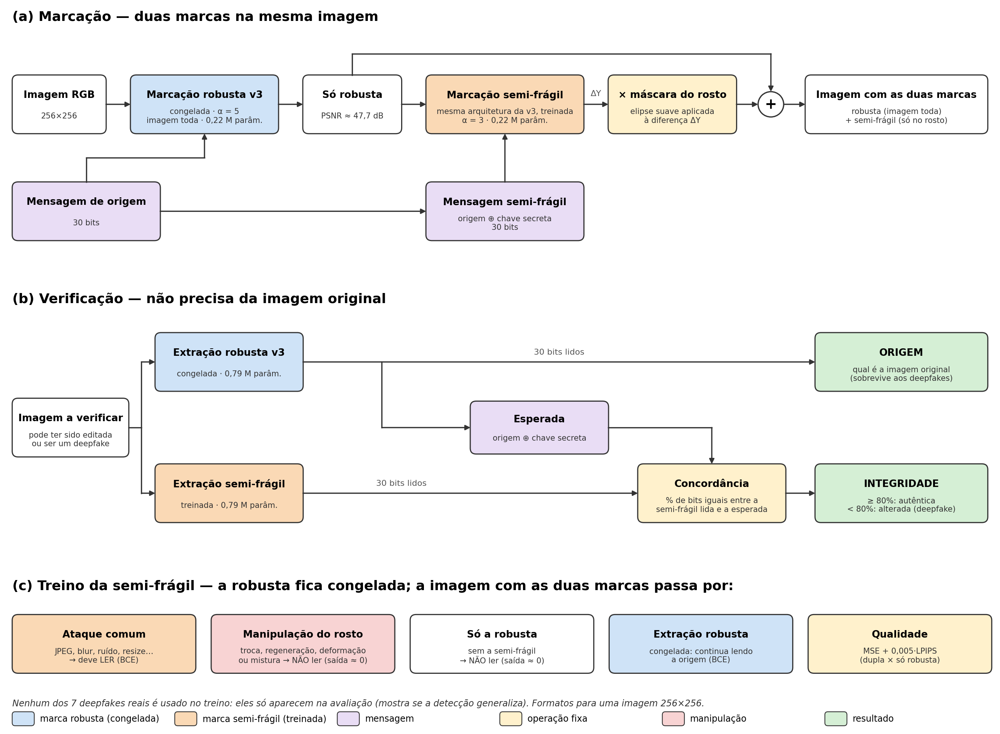
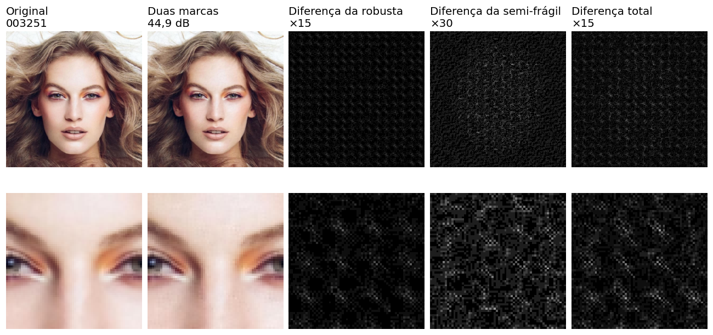

# Marca dupla para rostos 256×256: robusta + semi-frágil (versão 4)

Duas marcas d'água invisíveis de **30 bits** na mesma imagem de rosto (CelebA-HQ, 256×256), lidas sem precisar da imagem original:

| | Marca robusta (versão 3, congelada) | Marca semi-frágil (nova) |
|---|---|---|
| Onde fica | imagem toda | **só no rosto** (elipse suave posicionada pelo detector de rosto) |
| Ataques comuns (JPEG, blur, ruído, resize…) | sobrevive | **sobrevive** |
| Deepfake | sobrevive → diz a **origem** | **quebra** → diz que a imagem foi **alterada** |

A robusta é a da versão 3 ([robust-watermark-model](https://github.com/DevFelipeN/robust-watermark-model)), na versão atual dela: **sem o bloco SE e com pesos fixos na entrada do extrator**. Este projeto acrescenta a semi-frágil, treinada por cima dela.

## Como funciona

**Marcar:**

1. A imagem recebe a robusta v3.
2. O detector de rosto **SCRFD** dá a posição do rosto (5 pontos: olhos, nariz e cantos da boca).
3. A semi-frágil é escrita por cima, com a mesma rede de marcação da v3 (Y → DWT Haar → DCT 8×8 → CNN → máscara mid-band → IDCT → IDWT). A diferença que ela causa é multiplicada por uma **elipse suave do rosto**, **deslocada até o rosto detectado** (o tamanho da elipse é sempre o mesmo). O fundo e o cabelo só têm a robusta.
4. A mensagem da semi-frágil não é livre: é a mensagem robusta **XOR uma chave** fixa (`marca_fragil.chave_fragil`).

**Verificar** (`avaliar_marca_dupla.py`):

1. lê a robusta → mensagem de origem (30 bits);
2. calcula a semi-frágil esperada = robusta lida XOR chave;
3. lê a semi-frágil e mede a **concordância** (fração de bits iguais à esperada);
4. concordância abaixo do limiar (padrão 0,8) → imagem **alterada**.

A leitura das duas marcas é feita na imagem inteira, sem detector: o SCRFD só decide onde a semi-frágil é escrita.

Cada marca tem o seu extrator (mesma arquitetura U-Net da v3, pesos diferentes). Os dois recebem as sub-bandas LL, LH e HL multiplicadas por **alpha × peso da sub-banda** (5 × 0,30 / 0,35 / 0,35 = 1,50 / 1,75 / 1,75), a mesma ponderação usada na marcação, fixa e salva no checkpoint (buffer `escala_entrada`).



Figura gerada por `gerar_figura_marca_dupla.py` (PNG e PDF em `my_tests/arquitetura/`).

### Treino da semi-frágil (`train_fragil.py`)

A robusta fica congelada. A semi-frágil começa dos pesos da robusta v3 e, a cada batch:

1. a imagem recebe a robusta e depois a semi-frágil (alpha fixo, 5), na elipse posicionada pelo rosto;
2. **ataque comum** (`--benign_attack_set benigno_realista`: nenhum, JPEG simulado e real com qualidade 50–95, blur, median 3, ruído leve, resize 0,5–0,9 e resize + JPEG) → o extrator da semi-frágil deve **ler** a mensagem (BCE);
3. **manipulação do rosto** (`marca_fragil.MANIPULACOES`, sorteada, sempre no rosto da imagem) → o extrator deve **não ler**: o alvo da BCE é 0,5 em todos os bits, ou seja, bits no acaso. Em metade das vezes um ataque comum vem depois, porque deepfakes reais também saem recomprimidos:
   - `troca_rosto`: cola o rosto de outra imagem (sem marca), com a cor ajustada e a borda suave;
   - `regenera_rosto`: o rosto perde os detalhes finos e ganha ruído novo, como a saída de um gerador;
   - `deforma_rosto`: campo de deformação suave no rosto, como uma reencenação;
   - `mistura_rosto`: mistura parcial de dois rostos;
   - `troca_miolo` (sutil): troca só olhos, nariz e boca, com borda bem suave;
   - `troca_detalhes` (sutil): mantém cor e forma do rosto e troca só a textura fina (onde a marca fica);
   - `edita_regiao` (sutil): troca uma região pequena (olhos, boca ou nariz);
4. **imagem só com a robusta** → o extrator da semi-frágil também deve não ler, para não aprender a "ler" a robusta, que sobrevive aos deepfakes;
5. **a robusta continua legível** com a semi-frágil por cima (BCE do extrator robusto congelado);
6. **qualidade**: MSE + 0,005 × LPIPS entre a imagem com as duas marcas e a só com a robusta. Só entra depois que a semi-frágil lê 85% nos ataques comuns e cresce até o peso máximo em 3.000 passos.

**Nenhum dos 7 deepfakes reais entra no treino.** Todos ficam para a avaliação, o que mostra se a detecção generaliza.

No fim de cada época, uma validação rápida (200 imagens do `val`) mostra a acurácia da semi-frágil e da robusta sem ataque, com JPEG 50, resize 0,5, blur e após cada manipulação, além do PSNR, e salva a melhor época em `<nome>_melhor.pth`. A validação mede as imagens como são e também com o rosto deslocado até ±40 px (chaves `deslocado | …`), e a nota da melhor época usa os dois.

### Elipse posicionada pelo rosto

1. `preparar_pontos_scrfd.py` detecta o rosto de cada imagem com o SCRFD-10G e salva os 5 pontos em `pontos_scrfd/train.npz` e `pontos_scrfd/val.npz` (incluídos no repositório). O **molde** é a posição média desses pontos no CelebA-HQ (onde a elipse foi desenhada).
2. `pontos_rosto.mascara_por_pontos` leva a elipse até o rosto de cada imagem. As regiões das manipulações (miolo, olhos, boca) acompanham o rosto do mesmo jeito.

Três modos (`--elipse`):

| Modo | O que faz |
|---|---|
| `posicao` (**modelo atual**) | a elipse é **só deslocada** até o centro do rosto, com o tamanho e a inclinação fixos |
| `scrfd` | a elipse acompanha posição, **escala e rotação** do rosto |
| `fixa` | a elipse fica sempre no centro da imagem (modelo anterior, sem detector) |

O modelo atual usa `posicao` porque as imagens são 256×256 com rostos de tamanho parecido: o que muda de uma foto para outra é a posição do rosto, não o tamanho. **No treino as imagens não são deslocadas** (`--aug_geometrica 0`): a elipse segue o rosto de cada imagem do CelebA-HQ como ele é.

### O que mudou em relação à versão anterior

| | Versão anterior | Versão atual |
|---|---|---|
| Robusta | v3 com bloco SE no extrator | v3 **sem SE**, com **pesos fixos** na entrada do extrator |
| Extrator da semi-frágil | com SE | **sem SE**, com os mesmos pesos fixos |
| Elipse da semi-frágil | fixa no centro da imagem | **deslocada até o rosto** detectado pelo SCRFD |

- **Por que tirar o SE:** com 3 canais, a camada do meio do SE tem um único neurônio, que nos modelos treinados ficou sempre negativo (zerado pelo ReLU). O SE virou 3 pesos fixos, iguais para qualquer imagem. No lugar dele, o extrator recebe a mesma ponderação da marcação (alpha × peso da sub-banda). Na robusta, isso subiu a marca exata média de 84,7% para 88,0% (veja o README da versão 3).
- **Por que o detector de rosto:** com a elipse fixa, o método supõe que o rosto está no centro da imagem. Com a elipse posicionada pelo SCRFD, a semi-frágil é escrita onde o rosto realmente está.
- **Resultado:** nas imagens do CelebA-HQ, o modelo atual fica no mesmo nível do anterior: alarme falso médio de 20,4% (antes 22,7%) e detecção média dos deepfakes de 49,4% (antes 50,5%). A detecção do BlendFace caiu (37,5% → 18,0%) e a do DiffAE subiu (15,5% → 27,5%).

## Modelo atual

| Item | Valor |
|---|---|
| Robusta | `output/checkpoints/robusta.pth` (12 MB, o mesmo `v3_extrator_pesos_final.pth` da versão 3: sem SE, com pesos fixos no extrator) |
| Semi-frágil | `output/checkpoints/semifragil.pth` (12 MB, a melhor época do treino: a 12 de 20) |
| Elipse | `posicao` (deslocada até o rosto pelo SCRFD, tamanho fixo) |
| Resolução / marcas | 256×256 / 30 bits cada |
| Alpha | 5 nas duas (salvo em cada checkpoint) |
| Treino da semi-frágil | 20 épocas a partir dos pesos da robusta, batch 16, LR em cosseno 5e-5 → 1e-6, sem deslocar as imagens (≈2h10 numa RTX 3090) |
| Dataset | CelebA-HQ 256×256: 28.000 imagens de treino e 2.000 de validação |

> Os dois checkpoints estão incluídos no repositório e são os padrões de todos os scripts. Eles só carregam com o `watermark_embedding.py` e o `watermark_extraction.py` daqui (a máscara DCT é o buffer `dct_band_mask`; a escala do extrator, o buffer `escala_entrada`). Os checkpoints antigos (com SE e elipse fixa) saíram da pasta, mas continuam no histórico do git e também carregam com este código.

## Instalação

### 1. Ambiente

```bash
conda env create -f environment.yml
conda activate watermark-v3
```

O mesmo ambiente da versão 3 (Python 3.12, PyTorch 2.11 com CUDA 12.8, `pytorch_wavelets`, `torch-dct`, `kornia`, `lpips`, `DISTS-pytorch`, `torchmetrics`, …). Para outra versão de CUDA, troque o índice do PyTorch no arquivo. Na primeira execução, o LPIPS e o DISTS baixam os próprios pesos.

### 2. Dataset

CelebA-HQ em 256×256, separado por gênero na validação (a avaliação usa metade de cada gênero):

```text
Dataset/
└── celeba_hq/
    ├── train/
    │   ├── female/   (imagens .jpg)
    │   └── male/
    └── val/
        ├── female/
        └── male/
```

Crie a pasta `Dataset/` na raiz do projeto (ela não está no repositório: a licença do CelebA-HQ não permite redistribuir as imagens). Uma fonte é o Kaggle (`kaggle datasets download -d lamsimon/celebahq`), que já vem em `train/` e `val/` com `female/` e `male/`. As imagens são redimensionadas para 256×256 pelos scripts. `Dataset/` também pode ser um link simbólico para um dataset que já esteja em outro lugar (`ln -s /caminho/do/dataset Dataset`).

### 3. Modelos treinados e pontos do rosto

Já vêm no repositório: os checkpoints em `output/checkpoints/` (veja [Modelo atual](#modelo-atual)) e os pontos do SCRFD das imagens do CelebA-HQ em `pontos_scrfd/`. Para treinar a semi-frágil de novo, veja [Treino](#treino).

## Uso

Todos os comandos rodam de dentro desta pasta, com o ambiente ativado.

### Avaliar a marca dupla (métricas principais)

```bash
python avaliar_marca_dupla.py --num_images 2000 --sem_deepfakes --output results/marca_dupla_2000
```

- Marca as imagens de validação com as duas marcas (a semi-frágil na elipse posicionada pelos pontos de `pontos_scrfd/val.npz`), aplica os **16 ataques** do `evaluate.py` da versão 3 e lê as duas marcas de cada imagem atacada.
- `--num_images N`: usa N imagens (metade de cada gênero; padrão 200).
- `--limiar`: concordância abaixo da qual a imagem é considerada alterada (padrão 0,8).
- `--fragil`, `--robusta`: outros checkpoints (padrão: os do modelo atual).
- Use um `--output` diferente a cada execução: a pasta é sobrescrita.

Saídas em `--output`:

- `media_per_attack.csv`: a mesma tabela do `evaluate.py` (robusta: BER, Bit Accuracy, Accuracy; PSNR, SSIM, LPIPS e DISTS entre a original e a atacada) e mais três colunas da semi-frágil:
  - `Semi-frágil Acc (%)`: fração de bits certos da semi-frágil;
  - `Concordância (%)`: semi-frágil lida × esperada (robusta lida XOR chave);
  - `Alterada (%)`: imagens com concordância abaixo do limiar (falso positivo nos ataques comuns, detecção nos deepfakes).

  A última linha (`sem_semifragil`) é um controle: a imagem só com a robusta, em que a semi-frágil deve dar ≈50%.
- `results_per_image.csv`: uma linha por imagem e ataque.
- `qualidade.csv` e `qualidade_por_imagem.csv`: original × dupla e original × só robusta.
- `exemplo.png`: original | só robusta | dupla | diferença da semi-frágil ×20.

O terminal mostra também a taxa de falsos positivos nos ataques comuns, a taxa de detecção nos deepfakes, a origem recuperada nos deepfakes e a AUC.

### Avaliar com deepfakes (opcional)

```bash
python avaliar_marca_dupla.py --num_images 200 --output results/marca_dupla_deepfakes_200
```

Sem `--sem_deepfakes`, roda também os 7 deepfakes: DiffAE (atributo `Young`), BlendFace, SimSwap, InSwapper, StarGAN (`Male`), HiSD (óculos) e LivePortrait (`--deepfakes inswapper,simswap` escolhe quais). Cada imagem recebe uma identidade de origem fixa do mesmo gênero (`pares_origem.csv`). Exige os modelos de deepfake e um ambiente conda para cada um, que **não estão neste repositório**. Os caminhos ficam no início de `deepfake_attack.py` e podem ser trocados pelas variáveis de ambiente `DEEPFAKE_ROOT` (pasta com os modelos: `BlendFace/`, `SimSwap/`, `inswapper/`, `stargan/`, `HiSD/`, `LivePortrait/`, `diffae256/` e `origens_faceswap/`) e `CONDA_ENVS` (pasta dos ambientes conda, um por modelo: `blendeface`, `simswap`, `inswapper`, `stargan`, `liveportrait`, `diffae`). O DiffAE leva ≈11 s por imagem.

### Testar com o rosto fora do centro

```bash
python comparar_deslocado.py --num_images 500 --output results/comparar_deslocado
python comparar_deslocado.py --num_images 500 --fixa <semi-frágil com elipse fixa>.pth --output results/comparar_deslocado_fixa
```

As mesmas imagens de validação passam por quatro cenários **antes** de serem marcadas, como se fossem outras fotos: `original`, `deslocado` (rosto até ±40 px fora do lugar), `rosto 75%` e `rosto 50%` (imagem reduzida, girada até ±15° e deslocada). Em cada cenário, mede o alarme falso em 5 ataques comuns e a detecção nas 7 manipulações do treino, feitas no rosto verdadeiro. Sem argumentos, avalia só o modelo atual; `--fixa` e `--scrfd` acrescentam modelos para comparar. Saída: `resultados.csv` e a tabela de % de imagens acusadas de alteradas no terminal.

### Marcar uma imagem e ver a diferença

```bash
python collect_image_by_diff.py --models_path output/checkpoints/robusta.pth \
    --fragil output/checkpoints/semifragil.pth \
    --dataset_dir Dataset/celeba_hq/val --output_dir my_tests/exemplo \
    --reference_name 003251 --reference_file 003251.jpg --image_resolution 256

# diferença da semi-frágil (só robusta × dupla)
python watermark_diff.py --original my_tests/exemplo/003251_so_robusta.png \
    --watermarked my_tests/exemplo/003251_marcada.png --output_dir my_tests/exemplo/diff_semifragil

# diferença das duas marcas (original × dupla)
python watermark_diff.py --original my_tests/exemplo/003251_original.png \
    --watermarked my_tests/exemplo/003251_marcada.png --output_dir my_tests/exemplo/diff_dupla
```

O primeiro salva a original, a imagem só com a robusta e a imagem com as duas marcas; o `watermark_diff.py` gera a diferença amplificada (`diferenca.png`), um grid comparativo e imprime o PSNR. Troque `--reference_file` para usar outra imagem do dataset.

> O `collect_image_by_diff.py` escreve a semi-frágil na elipse **fixa** do centro, sem os pontos do SCRFD. Para as imagens do CelebA-HQ, com o rosto centralizado, o resultado é quase o mesmo; a avaliação usa sempre a elipse posicionada pelo rosto.

### Treino

Os pontos do SCRFD já estão em `pontos_scrfd/`. Para gerá-los de novo (≈10 min; ambiente `detectores`, com onnxruntime e insightface, e o modelo `scrfd_10g.onnx` em `../../detetores_rostos/modelos/` ou passado em `--modelo`):

```bash
~/miniconda3/envs/detectores/bin/python preparar_pontos_scrfd.py
```

Treino do modelo atual (ambiente `watermark-v3`):

```bash
python train_fragil.py --dataset_path Dataset/celeba_hq/train \
    --output output_fragil/fragil_posicao --num_epochs 20 \
    --elipse posicao --aug_geometrica 0
```

Opções principais:

| Opção | Padrão | O que faz |
|---|---|---|
| `--robust_checkpoint` | `output/checkpoints/robusta.pth` | marca robusta (congelada) |
| `--alpha` | 5 | força da semi-frágil (fixa) |
| `--elipse` | `scrfd` | `posicao` = elipse deslocada até o rosto (modelo atual); `scrfd` = acompanha também escala e rotação; `fixa` = no centro |
| `--aug_geometrica` | 0,7 | fração das imagens reduzidas, giradas e deslocadas a cada lote (**0 no modelo atual**) |
| `--aug_escala`, `--aug_rotacao`, `--aug_deslocamento` | dependem de `--elipse` | faixa de escala, rotação máxima (graus) e deslocamento extra (px) do aumento |
| `--pontos`, `--val_pontos` | `pontos_scrfd/train.npz`, `pontos_scrfd/val.npz` | pontos do SCRFD |
| `--mask_floor` | 0 | fração da semi-frágil fora do rosto (0 = só no rosto) |
| `--fragility_weight` | 1,0 | peso de "não ler" nas manipulações |
| `--no_mark_weight` | 0,5 | peso de "não ler" sem a marca semi-frágil |
| `--robust_weight` | 1,0 | peso que mantém a robusta legível |
| `--benign_attack_set` | `benigno_realista` | ataques que a semi-frágil deve aguentar (`benigno` = com dropout e JPEG até 30; `v3` = os mesmos da robusta) |
| `--manipulacoes` | as 7 | manipulações de treino, separadas por vírgula |
| `--init_from` | `robusta` | `zero` = começa com pesos aleatórios |
| `--resume` | — | continua o treino de um checkpoint da semi-frágil |
| `--limit` | 0 | usa só N imagens (teste rápido) |

- O treino salva em `<output>/checkpoints/` o `*_melhor.pth` (melhor época, o usado no modelo atual) e o `*_final.pth`, e os logs do TensorBoard em `<output>/logs/` (`tensorboard --logdir <output>/logs`). Checkpoints e logs não vão para o repositório (`.gitignore`), exceto os dois de `output/checkpoints/`.
- A nota da validação sobe até ≈38 na época 5 e depois oscila entre 36 e 41: 10 a 12 épocas já dão o mesmo resultado.
- Use um `--output` diferente para cada treino.

## Resultados do modelo atual

`avaliar_marca_dupla.py`, alpha 5 nas duas marcas, limiar 0,8, seed 42.

### Qualidade (2.000 imagens de validação)

| | PSNR | SSIM | LPIPS | DISTS |
|---|---|---|---|---|
| Original × só robusta | 47,72 dB | 0,992 | 0,0034 | 0,029 |
| Original × robusta + semi-frágil | 46,11 dB | 0,988 | 0,0057 | 0,035 |

A semi-frágil custa ≈1,6 dB de PSNR, concentrados no rosto. A linha "só robusta" vem da avaliação da versão 3 (mesmas 2.000 imagens).

### Ataques comuns (2.000 imagens)

"Robusta" é a Bit Accuracy da marca de origem; "Semi-frágil" é a Bit Accuracy da semi-frágil (bits lidos × bits inseridos); "Concordância" é a semi-frágil lida × esperada (robusta lida XOR chave), que é o que a verificação usa; "Alterada" é a fração de imagens que a verificação marcaria como alteradas (aqui, **falso positivo**).

| Ataque | Parâmetro | Robusta | Semi-frágil | Concordância | Alterada |
|---|---|---|---|---|---|
| Nenhum | – | 100% | 99,93% | 99,93% | 0% |
| JPEG | Q=75 | 99,96% | 98,35% | 98,31% | 0,1% |
| JPEG | Q=50 | 99,43% | 93,81% | 93,31% | 1,05% |
| JPEG | Q=30 | 95,32% | 81,79% | 78,76% | 45,7% |
| Blur | σ=2 | 99,88% | 97,41% | 97,29% | 0,35% |
| Median | 3×3 | 99,87% | 97,49% | 97,38% | 0,45% |
| Median | 5×5 | 99,41% | 90,12% | 89,69% | 7,25% |
| Ruído | σ=0,02 | 99,998% | 99,68% | 99,68% | 0,05% |
| Ruído | σ=0,05 | 99,79% | 94,84% | 94,65% | 0,2% |
| Salt & pepper | 1% | 99,99% | 97,37% | 97,36% | 0% |
| Salt & pepper | 5% | 99,39% | 79,53% | 79,18% | 44,05% |
| Dropout | 5% | 99,85% | 80,38% | 80,30% | 40,05% |
| Dropout | 10% | 99,55% | 72,45% | 72,30% | 70,05% |
| Dropout | 20% | 97,99% | 65,65% | 65,13% | 88,25% |
| Resize | 0,5 | 99,65% | 94,14% | 93,87% | 2,0% |
| Resize | 0,3 | 98,05% | 84,15% | 82,91% | 27,15% |
| Controle: só a robusta | – | 100% | 49,96% | 49,96% | 100% |

- A robusta continua acima de 95% de Bit Accuracy em todos os ataques, com a semi-frágil por cima.
- Nas edições comuns e leves (JPEG 75 e 50, blur, median 3, ruído, salt & pepper 1%, resize 0,5), a semi-frágil quase nunca acusa alteração (≤2%).
- Ataques que destroem a imagem (JPEG 30, salt & pepper 5%, dropout, resize 0,3) também quebram a semi-frágil: eles ficam fora do conjunto benigno do treino (veja [Limitações](#limitações)). Média do alarme falso nos 16 ataques: 20,4%.
- No controle, sem a semi-frágil, a concordância fica em ≈50% (acaso) e a imagem é acusada como alterada: o extrator da semi-frágil não lê a robusta.

### Deepfakes (200 imagens, 100 femininas e 100 masculinas)

"Alterada" aqui é a **taxa de detecção**.

| Deepfake | Robusta (origem) | Semi-frágil | Concordância | Alterada |
|---|---|---|---|---|
| SimSwap | 99,95% | 48,67% | 48,68% | 100% |
| InSwapper | 99,67% | 49,67% | 49,57% | 100% |
| LivePortrait | 85,35% | 51,57% | 52,42% | 96,5% |
| DiffAE (Young) | 99,95% | 87,23% | 87,18% | 27,5% |
| BlendFace | 100% | 90,10% | 90,10% | 18,0% |
| HiSD (óculos) | 99,38% | 91,83% | 91,35% | 3,0% |
| StarGAN (Male) | 99,75% | 95,30% | 95,05% | 1,0% |

- **Troca de rosto completa** (SimSwap, InSwapper) e **reencenação** (LivePortrait) são detectadas em quase todas as imagens, e a robusta continua dizendo a origem.
- **DiffAE** e **BlendFace** são detectados em parte.
- **Edições de atributo** (HiSD, StarGAN) preservam a maior parte da textura do rosto e quase não quebram a semi-frágil.
- Média de detecção: 49,4%. AUC (concordância, deepfake × ataque comum): 0,68.

### Rosto fora do centro (`comparar_deslocado.py`, 500 imagens)

% de imagens acusadas de alteradas. Nos ataques comuns, quanto **menor**, melhor (alarme falso); nas manipulações, quanto **maior**, melhor (detecção). "Fixa" é uma semi-frágil treinada do mesmo jeito, sobre a mesma robusta, mas com a elipse fixa no centro.

| | Original: fixa | Original: **posição** | Deslocado ±40 px: fixa | Deslocado ±40 px: **posição** |
|---|---|---|---|---|
| Sem ataque | 0 | 0 | 0 | 0,2 |
| JPEG 50 | 0,4 | 1,0 | 2,0 | 5,6 |
| Resize 0,5 | 2,4 | 2,2 | 5,8 | 8,0 |
| troca_rosto | 99,6 | 100 | 99,8 | 99,6 |
| mistura_rosto | 97,8 | 98,2 | 95,2 | 98,0 |
| troca_miolo | 99,0 | 99,2 | 99,4 | 99,6 |
| edita_regiao | 34,2 | 30,4 | 34,2 | 35,8 |

- Com a elipse posicionada pelo rosto, a semi-frágil detecta as manipulações tanto com o rosto no lugar quanto deslocado.
- Com deslocamentos de até ±40 px, a elipse fixa ainda funciona, porque ela é grande e o rosto deslocado continua sobre boa parte dela.

### Aparência das marcas



*Imagem 003251: original, com as duas marcas, e as diferenças da robusta (×15), da semi-frágil (×30, concentrada no rosto) e total (×15); embaixo, recorte ampliado. Figura feita com o modelo anterior (com SE e elipse fixa); a marcação do modelo atual usa a mesma arquitetura e a mesma máscara.*

### Limitações

- **Fronteira benigno × malicioso:** JPEG 30, dropout, salt & pepper 5% e resize 0,3 derrubam a semi-frágil junto com os deepfakes. O limiar e o conjunto de ataques considerados benignos precisam ser definidos e justificados.
- **Edição de atributos** (HiSD, StarGAN) é pouco detectada, e DiffAE, BlendFace e `edita_regiao` só em parte.
- **Pontos do rosto calculados antes:** a avaliação e o treino usam os pontos do SCRFD salvos em `pontos_scrfd/`. Uma imagem sem pontos salvos recebe a posição média (a mesma da elipse fixa). Em uso real, o detector precisa rodar na hora, em cada imagem nova.
- **Tamanho do rosto:** a elipse só é deslocada, não muda de tamanho. Rostos muito menores ou maiores que os do CelebA-HQ ficam fora do escopo.
- **LivePortrait** continua sendo o caso mais difícil para a robusta (85% de Bit Accuracy).

## Arquivos principais

| Arquivo | Função |
|---|---|
| `marca_fragil.py` | elipse do rosto, inserção da semi-frágil, manipulações de treino e chave |
| `pontos_rosto.py` | elipse posicionada pelos pontos do rosto e aumento geométrico do treino |
| `preparar_pontos_scrfd.py` | detecta os 5 pontos do rosto (SCRFD-10G) de cada imagem e salva em `pontos_scrfd/` |
| `pontos_scrfd/` | pontos do SCRFD do CelebA-HQ (`train.npz`, `val.npz`) |
| `train_fragil.py` | treino da semi-frágil com a robusta congelada |
| `avaliar_marca_dupla.py` | avaliação da marca dupla (origem + detecção) com 16 ataques e, opcionalmente, 7 deepfakes |
| `comparar_deslocado.py` | avaliação com o rosto fora do centro (deslocado, reduzido e girado) |
| `attacks.py` | ataques da versão 3 + os conjuntos `benigno` e `benigno_realista` |
| `watermark_embedding.py`, `watermark_extraction.py` | redes de marcação e extração (as mesmas da versão 3: sem SE, com a escala fixa da entrada) |
| `deepfake_attack.py` | chamada dos modelos de deepfake externos |
| `collect_image_by_diff.py`, `watermark_diff.py` | marcar uma imagem (com `--fragil`, as duas marcas) e visualizar a diferença |
| `gerar_figura_marca_dupla.py`, `gerar_figura_arquitetura.py` | figuras da arquitetura (`my_tests/arquitetura/`) |
| `train.py` | treino da robusta (o mesmo da versão 3) |
| `output/checkpoints/robusta.pth`, `output/checkpoints/semifragil.pth` | checkpoints do modelo atual |
| `utils.py` | DWT/DCT em blocos e funções auxiliares |
| `environment.yml` | ambiente conda |
